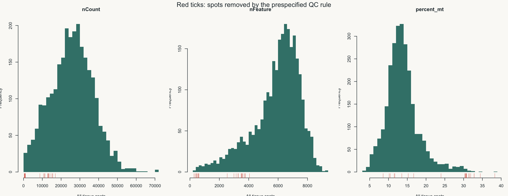
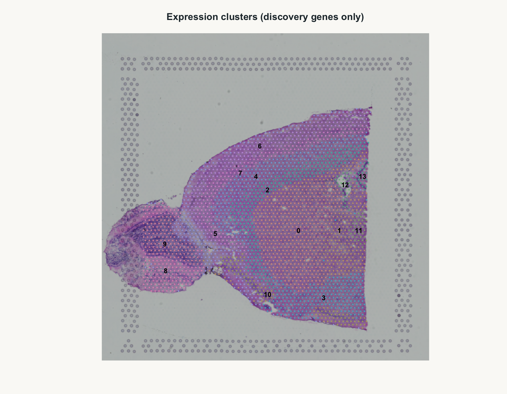
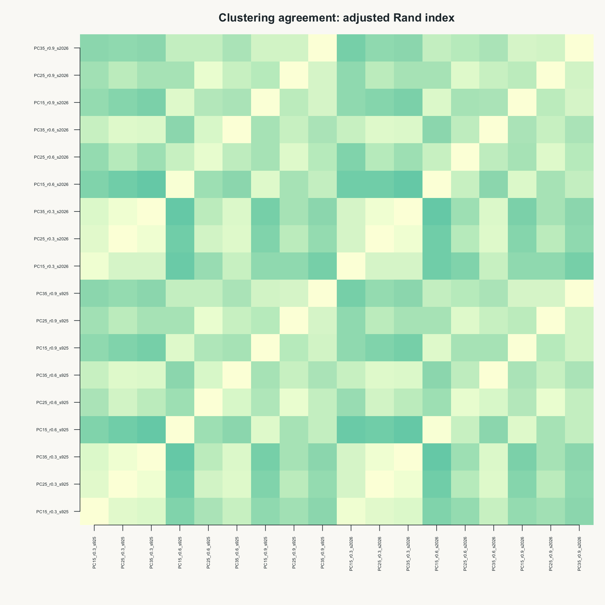
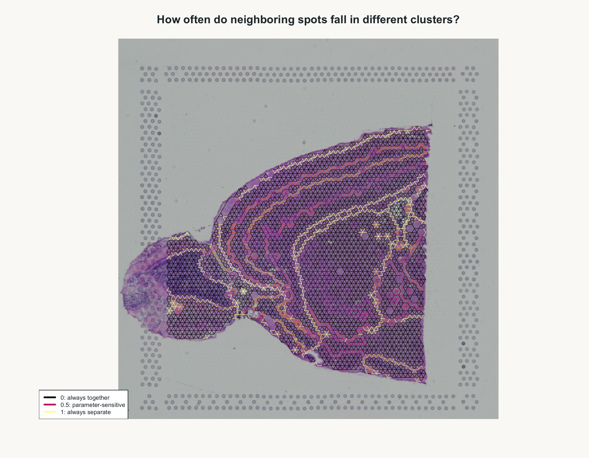
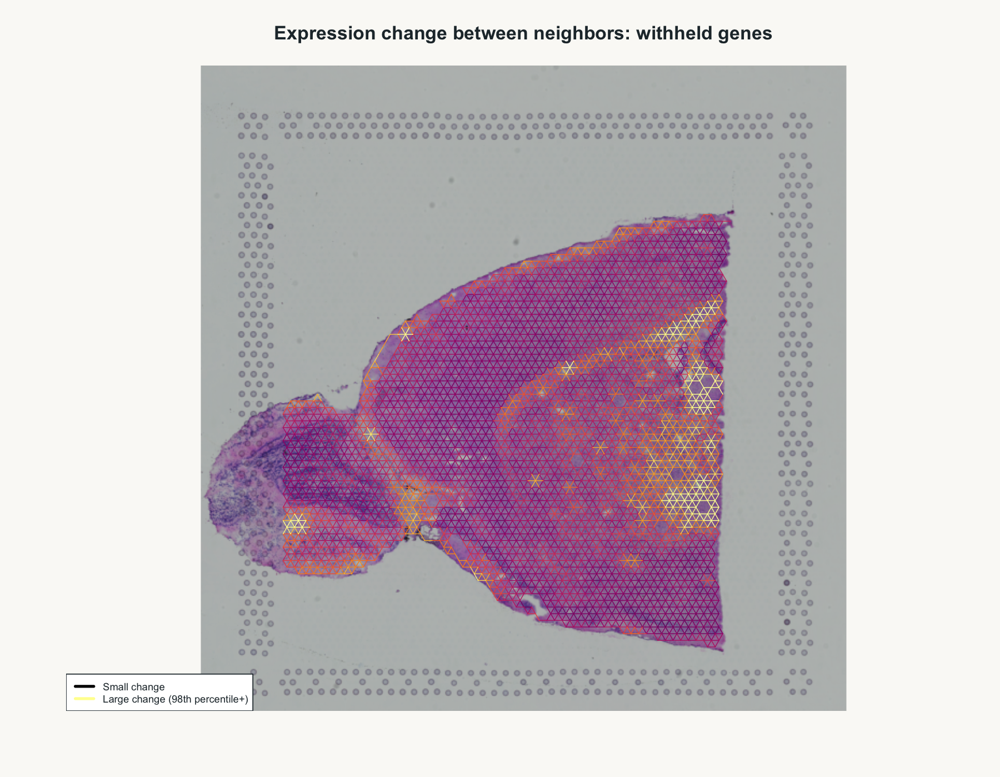
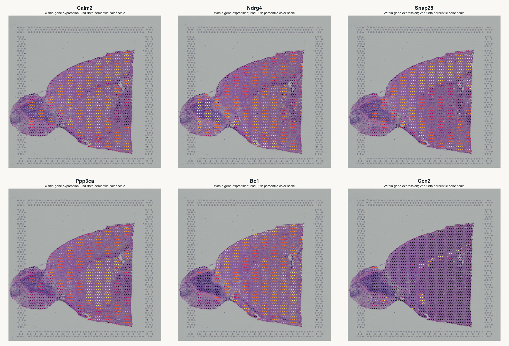
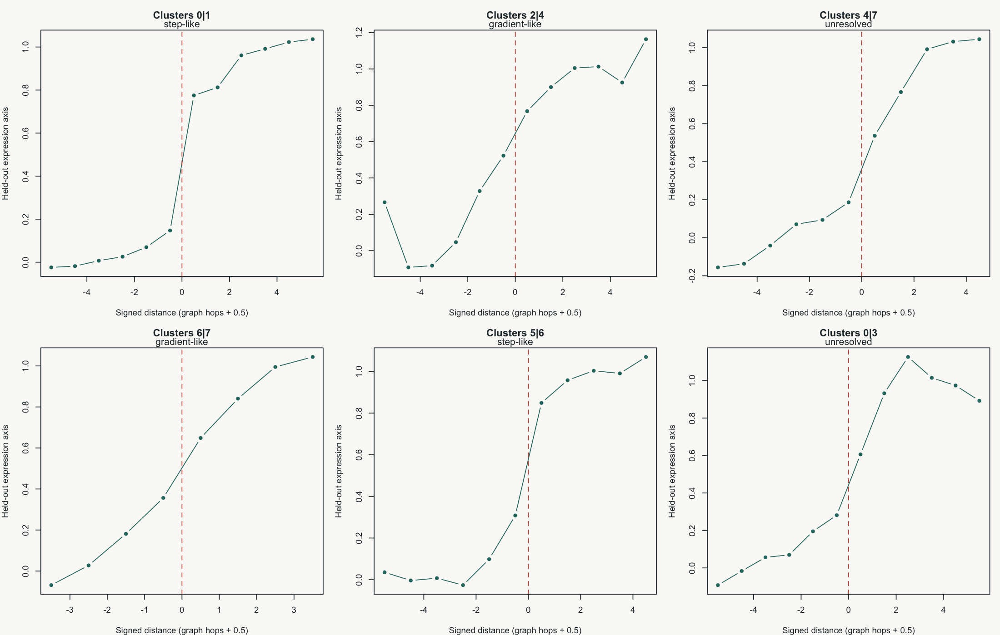
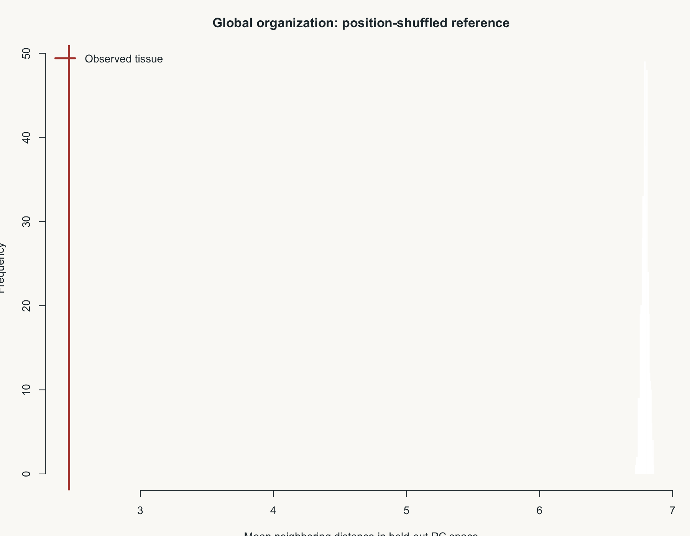

# Where Does the Brain End?
## Stable molecular borders and gradual transitions in a mouse brain section

**An exploratory analysis implemented entirely in R.** This report is generated from the downloaded biological data; numerical statements below are calculated by the workflow.

**Main results.** The analysis retained 2672 spots and audited 18 clustering runs. It identified 927 stable boundary edges. Among the sampled cluster-pair interfaces, 8 favored a step, 3 favored a gradient, and 7 were unresolved by the specified comparison. The boundary/interior held-out change ratio was 1.182 before QC matching and 1.033 on the QC-matched common-support comparison. These comparisons use different edge weights/subsets; the matched result should be considered alongside the raw contrast.

### Research question

Which molecular interfaces remain separated across reasonable clustering settings, and do expression profiles across those interfaces behave more like abrupt steps or gradual gradients at Visium spot resolution?

The working hypothesis is that brain organization includes both persistent molecular separations and transitions that a discrete clustering map can make appear sharper than they are. A parameter-sensitive border is a candidate for further inspection; instability alone does not establish a biological transition.

### Why this analysis adds something

This project produces an interface audit rather than stopping at a cluster map. It combines parameter sensitivity, genes withheld from discovery, and spatially blocked comparisons of step and gradient profiles on a specific adult mouse section. The contribution is a reproducible assessment of the strength and limits of each molecular interface in this dataset.

Spatial segmentation and molecular boundary detection already have a substantial literature. BANKSY incorporates neighborhood information for spatial clustering, while StarTrail studies localized expression gradients. Consequently, neither graph-based spatial analysis nor detecting brain boundaries is claimed as a new invention here. See [BANKSY (Nature Genetics, 2024)](https://www.nature.com/articles/s41588-024-01664-3) and [StarTrail (JASA, 2026)](https://doi.org/10.1080/01621459.2026.2654225).

### Data and scope

Source: [10x Genomics, Mouse Brain Serial Section 1 (Sagittal-Anterior)](https://www.10xgenomics.com/datasets/mouse-brain-serial-section-1-sagittal-anterior-1-standard-1-1-0).

The source describes one sagittal-anterior section from an adult male C57BL/6 mouse, analyzed with Space Ranger 1.1.0. The download includes gene counts, spot coordinates, a tissue image, and image scale factors. The source dataset is CC BY 4.0; attribution is to 10x Genomics. Raw-file URLs and locally computed MD5 checksums are in `data/raw/anterior1/download_manifest.csv`.

These are multicellular capture spots, not individual cells. Cluster numbers label expression-defined domains and are not automatically anatomical labels. One section from one donor cannot support population-level claims or estimates of cellular boundary widths.

### Prespecified analysis choices

- Retain tissue spots with at least 200 detected genes, 1000 UMIs, and at most 30% mitochondrial counts.
- Exclude mitochondrial and ribosomal genes from discovery and validation features, while retaining their counts for QC.
- Split eligible genes at random before feature selection. Choose variable discovery genes using Seurat's VST ranking, then log-normalize, scale, and fit PCA. Normalization uses total counts, including validation genes; this is feature withholding rather than complete statistical independence.
- Compare 15/25/35 PCs, clustering resolutions 0.3/0.6/0.9, and 2 random seeds (18 total Louvain clustering runs).
- Connect only immediate neighbors on the original Visium hexagonal lattice. Missing or QC-removed spots are not bridged by artificial nearest-neighbor edges.
- Call edges with separation frequency >= 0.8 stable boundaries and <= 0.2 stable interiors. These thresholds are descriptive choices.
- Evaluate molecular differences using 1000 high-variance held-out genes. They are selected without cluster labels or boundary scores.

The Seurat steps follow its [spatial analysis documentation](https://satijalab.org/seurat/articles/spatial_vignette.html), with log-normalization used here to keep the gene split explicit. The workflow uses R implementations and Louvain clustering; it does not require Python.

### Quality control

Of **2695** tissue spots, **2672** were retained and **23** removed. The retained spatial graph has **7709** edges.

The thresholds are deliberately permissive because spatial depth differences can reflect tissue biology. `spot_qc.csv` contains every exclusion. This run does not establish robustness to alternative QC or normalization choices.

### Result 1: cluster maps change with analysis settings

The number of clusters ranged from **10 to 18**. The baseline used 25 PCs, resolution 0.6, and seed 925.

| pcs | resolution | seed | clusters | ari_to_baseline | boundary_jaccard_to_baseline |
| --- | --- | --- | --- | --- | --- |
| 15 | 0.3 | 925 | 11 | 0.734 | 0.585 |
| 25 | 0.3 | 925 | 11 | 0.840 | 0.748 |
| 35 | 0.3 | 925 | 10 | 0.770 | 0.595 |
| 15 | 0.6 | 925 | 14 | 0.707 | 0.536 |
| 25 | 0.6 | 925 | 14 | 1.000 | 1.000 |
| 35 | 0.6 | 925 | 13 | 0.859 | 0.750 |
| 15 | 0.9 | 925 | 15 | 0.744 | 0.586 |
| 25 | 0.9 | 925 | 17 | 0.918 | 0.864 |
| 35 | 0.9 | 925 | 18 | 0.798 | 0.686 |
| 15 | 0.3 | 2026 | 10 | 0.698 | 0.527 |
| 25 | 0.3 | 2026 | 11 | 0.840 | 0.748 |
| 35 | 0.3 | 2026 | 10 | 0.770 | 0.595 |
| 15 | 0.6 | 2026 | 14 | 0.707 | 0.555 |
| 25 | 0.6 | 2026 | 13 | 0.901 | 0.815 |
| 35 | 0.6 | 2026 | 13 | 0.859 | 0.750 |
| 15 | 0.9 | 2026 | 15 | 0.752 | 0.604 |
| 25 | 0.9 | 2026 | 17 | 0.918 | 0.864 |
| 35 | 0.9 | 2026 | 18 | 0.795 | 0.685 |

Adjusted Rand index compares partitions without depending on arbitrary cluster numbering. Boundary Jaccard compares the sets of physical edges cut by each run and the baseline. A high value indicates similar assignments or interfaces, not proof of anatomical accuracy. The edge table also records PC stability at the baseline resolution and resolution stability at the baseline PC count, since changing resolution intentionally changes domain granularity.

### Result 2: some edges are more persistent than others

**927 of 7709 edges (12.0%)** met the stable-boundary threshold; **5621** met the stable-interior threshold.

For an edge connecting neighboring spots i and j, stability is the fraction of specified runs assigning i and j to different clusters. The runs share the same counts and are correlated. This fraction measures sensitivity over this parameter grid; it is not a probability that a biological boundary exists.

### Result 3: expression differences in withheld genes

Stable boundary edges had **1.182 times** the average held-out expression change of stable interior edges. The conditional spatial block bootstrap 95% interval was **[1.117, 1.237]**.

For each edge, the score is the root mean squared difference across gene-standardized, log-normalized held-out expression values. The contrast above divides its mean on stable boundaries by its mean on stable interiors. Intermediate edges are excluded from this contrast.

The bootstrap resamples whole spatial blocks of edge midpoints, conditional on the observed clustering and feature split. It does not resample mice, refit the pipeline, or remove all long-range dependence. Block-size sensitivity is in `tables/block_size_sensitivity.csv`. This interval describes within-section sensitivity and is not a biological-replicate confidence interval.

Genes with the largest boundary/interior ratios (descriptive ranking, no significance claims):

| gene | mean_abs_change_boundary | mean_abs_change_interior | ratio |
| --- | --- | --- | --- |
| Calm2 | 0.998 | 0.464 | 2.152 |
| Ndrg4 | 0.958 | 0.498 | 1.923 |
| Snap25 | 0.803 | 0.422 | 1.903 |
| Ppp3ca | 0.853 | 0.457 | 1.866 |
| Bc1 | 0.716 | 0.405 | 1.766 |
| Ccn2 | 0.867 | 0.495 | 1.751 |
| Atp1b1 | 0.925 | 0.529 | 1.748 |
| Ncdn | 1.028 | 0.590 | 1.743 |
| Baiap2 | 1.093 | 0.628 | 1.742 |
| Chn1 | 0.848 | 0.489 | 1.734 |
| Ppp3r1 | 1.024 | 0.592 | 1.729 |
| Snrpn | 1.026 | 0.598 | 1.717 |

*Snap25* is among the highest-ranked held-out genes. Its protein participates in neurotransmitter release and vesicle fusion, according to the [NCBI mouse SNAP-25 protein record](https://pubchem.ncbi.nlm.nih.gov/protein/P60879). Its spatial pattern is therefore a biologically plausible lead for examining differences in neuronal contributions across the tissue, rather than evidence that SNAP-25 creates the interface.
*Ndrg4* also appears among the highest-ranked genes. The [NCBI mouse Ndrg4 record](https://www.ncbi.nlm.nih.gov/gene/234593) annotates nervous-system expression and roles including vesicle docking and endocytic recycling. These annotations provide biological context for follow-up. They do not establish a specific brain-region identity, a change within a single cell type, or a causal mechanism in this section.

Genes covary in biological programs, so withholding genes reduces direct reuse but does not make validation independent. Gene rankings require checking expression levels, known biology, and independent data before interpreting mechanisms.

### Result 4: step versus gradient descriptions

For every baseline cluster pair sharing at least 10 spatial edges, graph distance is measured inward from the interface on both sides, up to five neighbor hops. An axis from the left to right domain interior summarizes held-out expression. The plotted profile uses all relevant spots and is descriptive.

For model comparison, that axis is recomputed using training blocks only in each of five folds. A constant model, a two-level step at the discovered interface, and a linear trend across signed graph distance are compared by held-out spot mean squared error. Models need at least five spatial blocks and adequate interiors on both sides. A model is labeled step-like or gradient-like only if its MSE is at least 5% lower than both alternatives; otherwise the result is unresolved. The 5% rule is a heuristic, not a statistical test.

| Var1 | interfaces |
| --- | --- |
| gradient-like | 3 |
| step-like | 8 |
| unresolved | 7 |

| interface | mean_stability | jump_fraction | cv_flat_mse | cv_step_mse | cv_linear_mse | model_preference |
| --- | --- | --- | --- | --- | --- | --- |
| 0/1 | 0.935 | 0.592 | 0.184 | 0.042 | 0.069 | step-like |
| 0/12 | 0.900 | 0.271 | 0.174 | 0.038 | 0.061 | step-like |
| 0/2 | 1.000 | 0.428 | 0.279 | 0.019 | 0.033 | step-like |
| 0/3 | 0.647 | 0.224 | 0.244 | 0.068 | 0.071 | unresolved |
| 1/3 | 0.882 | 0.494 | 0.278 | 0.090 | 0.127 | step-like |
| 1/5 | 0.895 | 0.317 | 0.217 | 0.090 | 0.094 | unresolved |
| 10/2 | 0.606 | 0.239 | 0.108 | 0.035 | 0.088 | step-like |
| 10/3 | 0.897 | 0.283 | 0.133 | 0.074 | 0.075 | unresolved |
| 10/5 | 0.821 | 0.376 | 0.177 | 0.041 | 0.059 | step-like |
| 2/3 | 0.965 | 0.329 | NA | NA | NA | unresolved |
| 2/4 | 0.439 | 0.137 | 0.126 | 0.048 | 0.040 | gradient-like |
| 3/5 | 0.697 | 0.238 | NA | NA | NA | unresolved |
| 4/7 | 0.755 | 0.292 | 0.115 | 0.036 | 0.038 | unresolved |
| 5/6 | 0.995 | 0.448 | 0.165 | 0.025 | 0.051 | step-like |
| 5/8 | 0.865 | 0.335 | 0.126 | 0.130 | 0.162 | unresolved |
| 5/9 | 0.960 | 0.364 | 0.285 | 0.075 | 0.070 | gradient-like |
| 6/7 | 0.613 | 0.263 | 0.103 | 0.037 | 0.028 | gradient-like |
| 8/9 | 0.917 | 0.315 | 0.205 | 0.032 | 0.044 | step-like |

**A concrete example:** cluster pair 5/9 had mean separation stability 0.960 but favored the linear gradient description under the specified rule. A consistently separated pair of molecular domains can therefore still have a gradual expression profile across their interface in this analysis. This is a conditional, spot-level finding, not evidence of a new anatomical structure.

A linear preference supports a gradual description within the sampled window; it does not prove a continuous cellular state. Step-like means abrupt relative to the sampled graph spacing. Each cluster-pair profile can pool spatially disconnected interface segments. Branching geometry, mixed-cell spots, curved interfaces, and other nearby domains can affect both fits, so local inspection remains necessary. Graph hops are not calibrated micrometers, and no sub-spot transition widths are inferred.

### Result 5: overall spatial organization

The observed mean neighboring distance in the first 10 held-out PCs was **2.463**, compared with a position-shuffled null mean of **6.793**. The lower-tail Monte Carlo p-value was **0.0020**, using 499 permutations and the +1 correction.

This is a test of the global exchangeability null: complete expression profiles can be assigned arbitrarily to tissue positions. It destroys spatial autocorrelation and tests overall organization only. It cannot test whether any individual border is significant, identify its cause, or establish anatomical agreement.

### Technical associations

| metric | spearman_with_heldout_change |
| --- | --- |
| absolute_log_depth_change | 0.388 |
| absolute_mitochondrial_change | 0.206 |

These are descriptive Spearman correlations across graph edges. Edges share spots and are not independent replicates. A correlation with depth or mitochondrial differences flags a possible technical or biological association; it does not separate the two.

**Exploratory QC-matched sensitivity analysis.** This check was added after observing the QC associations, rather than specified before the first data run. Edges are stratified by tertiles of four covariates: average log depth, absolute log-depth difference, average mitochondrial percentage, and absolute mitochondrial-percentage difference. Strata must contain at least three boundary and three interior edges. Interior edges are weighted to match the number of boundary edges within each supported stratum. The comparison is descriptive and has no separately estimated confidence interval.

| ratio | boundary_mean | matched_interior_mean | boundary_edges | interior_edges | supported_strata | excluded_boundary_edges |
| --- | --- | --- | --- | --- | --- | --- |
| 1.033 | 1.346 | 1.303 | 911 | 5236 | 72 | 16 |

| covariate | original_boundary_mean | original_interior_mean | common_support_boundary_mean | weighted_interior_mean |
| --- | --- | --- | --- | --- |
| mean_log_depth | 9.889 | 10.075 | 9.888 | 9.816 |
| abs_log_depth_change | 0.517 | 0.248 | 0.522 | 0.418 |
| mean_percent_mt | 14.057 | 13.397 | 14.067 | 13.810 |
| abs_mt_change | 3.530 | 1.825 | 3.576 | 2.706 |

Compare the matched ratio with the original unadjusted ratio, and inspect covariate balance and excluded edges. Coarse matching cannot remove every technical influence or distinguish a biological depth difference from a technical one. It changes the comparison to the common-support subset; it is not a causal adjustment or proof that the molecular contrast is independent of QC.

### What can be concluded

The analysis quantifies how stable expression-defined interfaces are under specified clustering settings, checks whether different genes also change there, and compares simple step and gradient descriptions with spatial block cross-validation. The numerical results support a dataset-specific characterization; they do not determine a universal answer about where the brain or any named region ends.

The H&E overlays allow visual inspection, but no independent anatomical labels are supplied by this pipeline. Therefore anatomical agreement is not measured here. A stronger follow-up would annotate histology while blinded to expression results, register an appropriate mouse-brain atlas, and repeat the analysis in independent sections or animals. Adjacent sections from one animal would assess technical/spatial reproducibility, not independent biological replication.

### Reproducibility

Run `Rscript scripts/setup.R`, `Rscript scripts/download_data.R`, and `Rscript scripts/run_analysis.R` from the repository root. The core validation checks run with `Rscript scripts/check.R`. All settings are in `config.R`; raw data, installed libraries, and large Seurat objects are excluded from Git. Package versions are in `tables/package_versions.csv`; the full environment is recorded in `session-info.txt`.

R source files: `R/boundaries.R`, `R/plotting.R`, `R/report.R`, and `scripts/run_analysis.R`. The analysis saves tables, figures, the Seurat object, and the complete result object locally. See the project README for interpretation and rerunning instructions.
