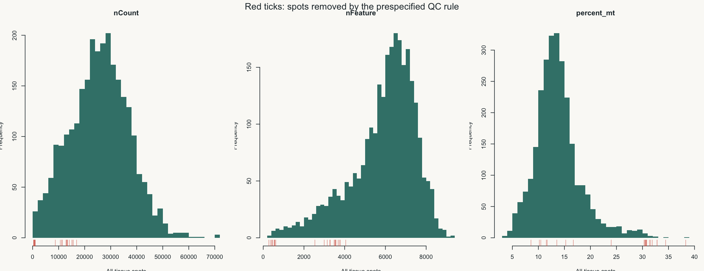
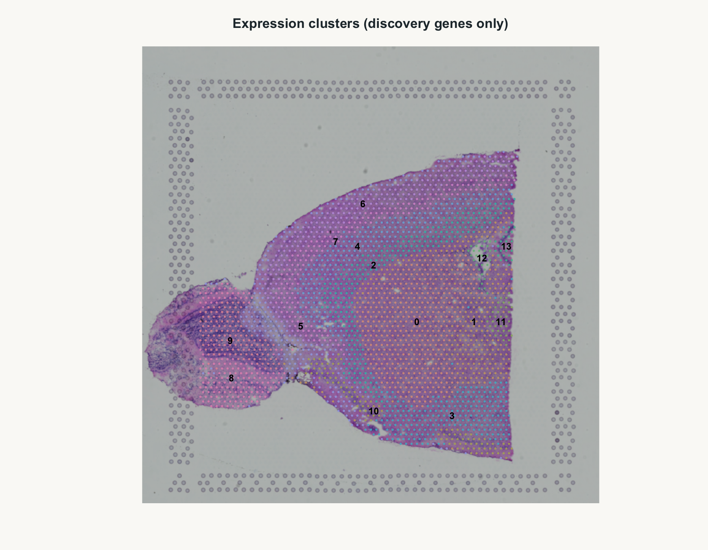
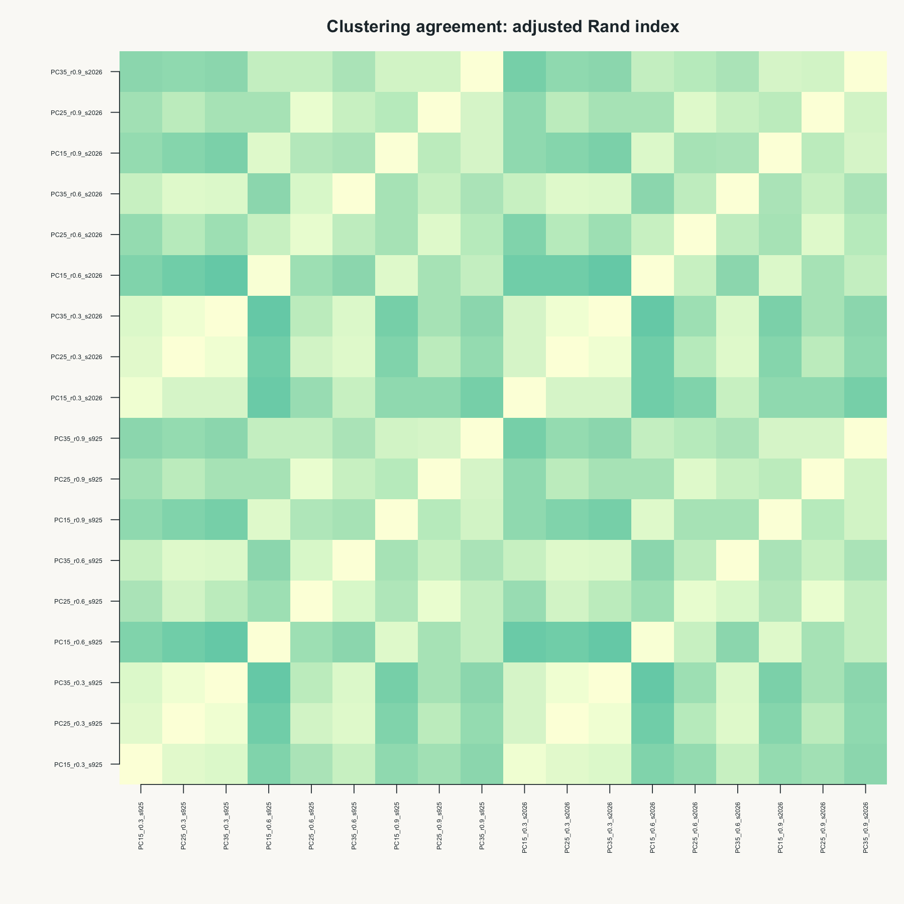
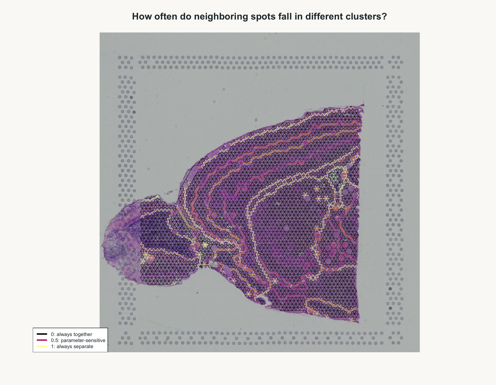
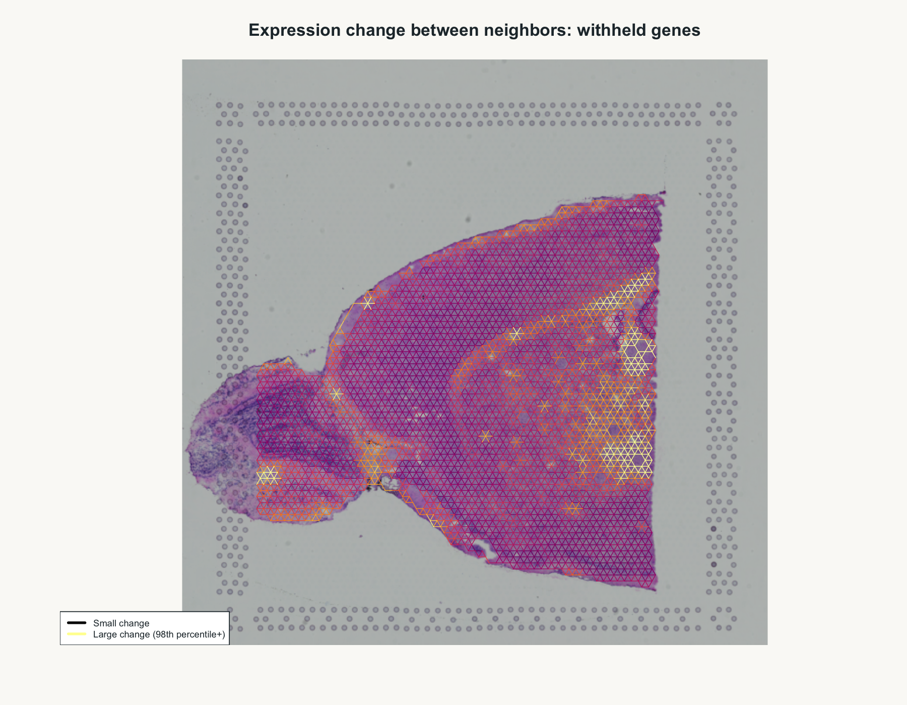
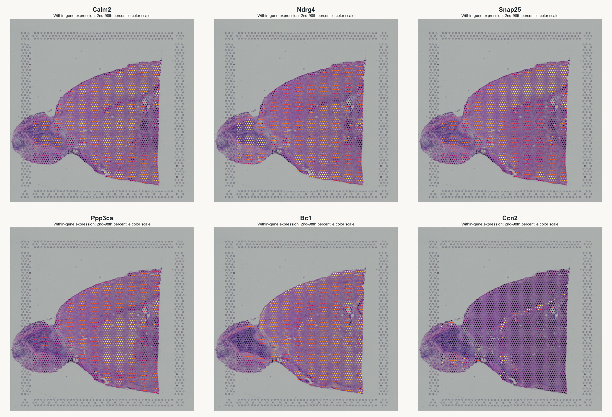
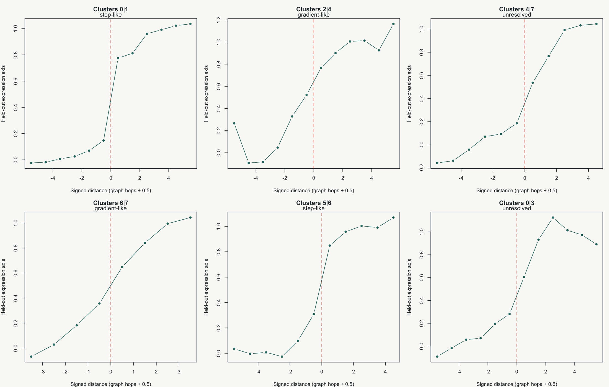
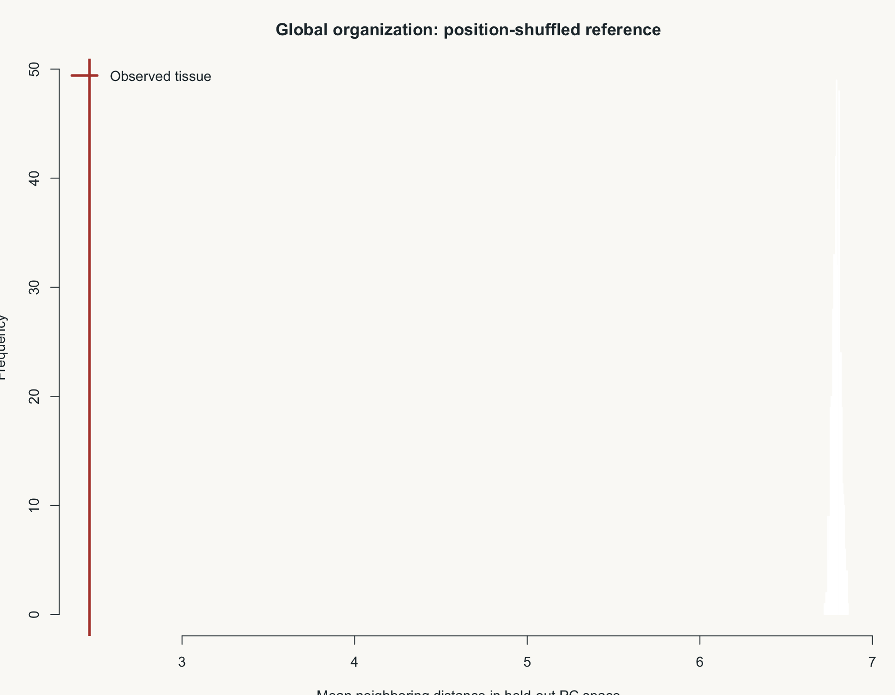

# Abstract

For this project, I looked at whether boundaries between brain regions stay in the same place when I change the clustering settings, and whether gene expression changes sharply or gradually across them. I used the 10x Genomics Mouse Brain Serial Section 1 (Sagittal-Anterior) dataset and Seurat. I ran 18 clustering versions with different numbers of PCs, resolutions, and random seeds. Then I checked the boundaries using genes that were not used to make the clusters.

I kept 2672 spots and found 927 edges that were consistently separated across runs. 8 interfaces looked step-like, 3 looked more gradual, and 7 did not clearly fit either one. Cluster pair 5/9 stood out to me. Its boundary showed up consistently (0.960 mean stability), but its expression pattern looked more like a gradient. So the cluster map kept showing this boundary even though expression changed gradually across it.

Before I accounted for spot quality, expression changes at stable boundaries were 1.182 times higher than at stable interiors. After matching edges with similar depth and mitochondrial percentage, the ratio was 1.033. The difference got smaller, so spot quality may explain part of the original result.

# Research question and motivation

For my project, I want to investigate whether the boundaries between different brain regions are as distinct at the molecular level as they appear anatomically. Two neighboring regions might look similar under a microscope but have very different gene expression, or regions we think of as separate might gradually transition into one another. This matters to me because the way we divide biological structures into regions may not always match what is happening at the molecular level.

I use the 10x mouse brain spatial transcriptomics data and Seurat to find gene expression patterns and map them to their positions in the tissue. I also connect neighboring spots in a graph so I can measure how expression changes across different areas. For this draft, I compared clustering results across settings, then checked whether the boundaries that kept showing up looked sharp or gradual. The question I am working on is: which boundaries stay in similar places when I change the settings, and what does expression do across them?

# Dataset and scope

The dataset is [10x Genomics Mouse Brain Serial Section 1 (Sagittal-Anterior)](https://www.10xgenomics.com/datasets/mouse-brain-serial-section-1-sagittal-anterior-1-standard-1-1-0). It is one sagittal-anterior section from an adult male C57BL/6 mouse, analyzed with Space Ranger 1.1.0. The download includes gene counts, spot coordinates, a tissue image, and scale factors. The source dataset is licensed CC BY 4.0.

The data are spots, not single cells, and each spot can contain several cells. The cluster numbers are labels from the expression analysis, not confirmed names for brain regions. Since this is one section from one mouse, I also cannot make a population-level claim from it.

# Analysis workflow in R

The full workflow is in `scripts/run_analysis.R`. These are the commands I used to set up and run the project:


``` r
Rscript scripts/setup.R
Rscript scripts/download_data.R
Rscript scripts/check.R
Rscript scripts/run_analysis.R
```

I used Seurat for normalization, variable-feature selection, PCA, nearest neighbors, and Louvain clustering. The functions in `R/boundaries.R` build the Visium spot graph, calculate how often an edge is a boundary, compare expression on neighboring spots, and fit the simple step and gradient models.

The main choices I made were:

* Retain tissue spots with at least 200 detected genes, 1,000 UMIs, and at most 30% mitochondrial counts.
* Exclude mitochondrial and ribosomal genes from discovery and validation features while retaining their counts for QC.
* Split the eligible genes before feature selection. I used one set to make the clusters and another set to check the result. This is not completely independent because normalization still uses total counts.
* Compare 15, 25, and 35 PCs; resolutions 0.3, 0.6, and 0.9; and seeds 925 and 2026, for 18 runs.
* Connect immediate neighbors on the original Visium hexagonal lattice. Missing or QC-removed spots are not bridged with artificial nearest-neighbor edges.
* Define stable boundary edges as separated in at least 80% of runs and stable interior edges as separated in at most 20% of runs.
* Score each edge using the root mean squared change across 1,000 high-variance validation genes.

I followed the general Seurat spatial workflow from the [Seurat spatial analysis documentation](https://satijalab.org/seurat/articles/spatial_vignette.html). Everything in this project is implemented in R.

# Quality control

Of 2695 tissue spots, 2672 were retained and 23 were removed. The retained graph contains 7709 spatial edges.



I kept the filters fairly permissive because low counts can reflect the tissue as well as poor quality. The individual keep/remove decisions are in `outputs/tables/spot_qc.csv`.

# Results

## Clustering sensitivity

The number of clusters ranged from 10 to 18. The baseline was 25 PCs, resolution 0.6, and seed 925. Adjusted Rand index compares spot partitions without depending on cluster numbering; boundary Jaccard compares the physical edges cut by each run with the baseline.


| pcs| resolution| seed| clusters| ari_to_baseline| boundary_jaccard_to_baseline|
|---:|----------:|----:|--------:|---------------:|----------------------------:|
|  15|        0.3|  925|       11|           0.734|                        0.585|
|  25|        0.3|  925|       11|           0.840|                        0.748|
|  35|        0.3|  925|       10|           0.770|                        0.595|
|  15|        0.6|  925|       14|           0.707|                        0.536|
|  25|        0.6|  925|       14|           1.000|                        1.000|
|  35|        0.6|  925|       13|           0.859|                        0.750|
|  15|        0.9|  925|       15|           0.744|                        0.586|
|  25|        0.9|  925|       17|           0.918|                        0.864|
|  35|        0.9|  925|       18|           0.798|                        0.686|
|  15|        0.3| 2026|       10|           0.698|                        0.527|
|  25|        0.3| 2026|       11|           0.840|                        0.748|
|  35|        0.3| 2026|       10|           0.770|                        0.595|
|  15|        0.6| 2026|       14|           0.707|                        0.555|
|  25|        0.6| 2026|       13|           0.901|                        0.815|
|  35|        0.6| 2026|       13|           0.859|                        0.750|
|  15|        0.9| 2026|       15|           0.752|                        0.604|
|  25|        0.9| 2026|       17|           0.918|                        0.864|
|  35|        0.9| 2026|       18|           0.795|                        0.685|





These numbers show how sensitive my results are to the settings I tried. They are not probabilities that a real anatomical boundary exists.

## Stable and unstable spatial interfaces

927 of 7709 edges (12.0%) met the stable-boundary threshold, while 5621 met the stable-interior threshold.



I called an edge stable when its two neighboring spots were separated in most of the runs. This tells me how reproducible the computational boundary is. It does not prove that the edge is a biological boundary.

## Held-out expression changes

Stable boundary edges had 1.182 times the average held-out expression change of stable interior edges. The spatial block bootstrap interval was [1.117, 1.237]. This only describes uncertainty within this one section. It is not a confidence interval across mice.



The highest descriptive gene ratios were:


|gene   | mean_abs_change_boundary| mean_abs_change_interior| ratio|
|:------|------------------------:|------------------------:|-----:|
|Calm2  |                    0.998|                    0.464| 2.152|
|Ndrg4  |                    0.958|                    0.498| 1.923|
|Snap25 |                    0.803|                    0.422| 1.903|
|Ppp3ca |                    0.853|                    0.457| 1.866|
|Bc1    |                    0.716|                    0.405| 1.766|
|Ccn2   |                    0.867|                    0.495| 1.751|
|Atp1b1 |                    0.925|                    0.529| 1.748|
|Ncdn   |                    1.028|                    0.590| 1.743|
|Baiap2 |                    1.093|                    0.628| 1.742|
|Chn1   |                    0.848|                    0.489| 1.734|
|Ppp3r1 |                    1.024|                    0.592| 1.729|
|Snrpn  |                    1.026|                    0.598| 1.717|



Snap25 and Ndrg4 stood out as possible follow-up genes because they are connected to nervous-system or neuronal functions. I would need more evidence before using them to name a brain region or explain why a boundary exists.

## Step-like versus gradient-like interfaces

For each cluster pair with enough spots, I measured graph distance moving away from the interface on both sides. I made an expression score from the held-out genes and compared three simple models: no change, a step, and a straight-line trend. I called a profile step-like or gradient-like only when its prediction error was at least 5% lower than the other two models. Otherwise I left it unresolved.


|profile       | interfaces|
|:-------------|----------:|
|gradient-like |          3|
|step-like     |          8|
|unresolved    |          7|


|interface | mean_stability| jump_fraction| cv_flat_mse| cv_step_mse| cv_linear_mse|model_preference |
|:---------|--------------:|-------------:|-----------:|-----------:|-------------:|:----------------|
|0&#124;1  |          0.935|         0.592|       0.184|       0.042|         0.069|step-like        |
|0&#124;12 |          0.900|         0.271|       0.174|       0.038|         0.061|step-like        |
|0&#124;2  |          1.000|         0.428|       0.279|       0.019|         0.033|step-like        |
|0&#124;3  |          0.647|         0.224|       0.244|       0.068|         0.071|unresolved       |
|1&#124;3  |          0.882|         0.494|       0.278|       0.090|         0.127|step-like        |
|1&#124;5  |          0.895|         0.317|       0.217|       0.090|         0.094|unresolved       |
|10&#124;2 |          0.606|         0.239|       0.108|       0.035|         0.088|step-like        |
|10&#124;3 |          0.897|         0.283|       0.133|       0.074|         0.075|unresolved       |
|10&#124;5 |          0.821|         0.376|       0.177|       0.041|         0.059|step-like        |
|2&#124;3  |          0.965|         0.329|          NA|          NA|            NA|unresolved       |
|2&#124;4  |          0.439|         0.137|       0.126|       0.048|         0.040|gradient-like    |
|3&#124;5  |          0.697|         0.238|          NA|          NA|            NA|unresolved       |
|4&#124;7  |          0.755|         0.292|       0.115|       0.036|         0.038|unresolved       |
|5&#124;6  |          0.995|         0.448|       0.165|       0.025|         0.051|step-like        |
|5&#124;8  |          0.865|         0.335|       0.126|       0.130|         0.162|unresolved       |
|5&#124;9  |          0.960|         0.364|       0.285|       0.075|         0.070|gradient-like    |
|6&#124;7  |          0.613|         0.263|       0.103|       0.037|         0.028|gradient-like    |
|8&#124;9  |          0.917|         0.315|       0.205|       0.032|         0.044|step-like        |



Cluster pair 5/9 is the clearest example of what I was looking for. Its mean separation stability was 0.960, but the profile favored a gradient. So this boundary keeps appearing in the cluster results, even though the expression change across it is not an obvious jump.

This does not prove that cells change continuously. Some profiles can combine separate pieces of the same cluster boundary. Mixed-cell spots, curved boundaries, and nearby domains can also affect the fits. The graph hops are not exact micrometer distances.

## Overall spatial organization

The observed mean neighboring distance in the first 10 held-out PCs was 2.463, compared with a position-shuffled null mean of 6.793. The lower-tail Monte Carlo p-value was 0.0020 using 499 permutations.



This checks whether the data are more spatially organized than they would be after shuffling expression profiles across the tissue. It does not test the significance of one particular boundary or show that a boundary matches anatomy.

## Quality-matched sensitivity analysis

Held-out expression change was related to absolute log-depth change (0.388) and absolute mitochondrial-percentage change (0.206). Because of that, I did an extra comparison that grouped edges with similar depth and mitochondrial values before comparing boundaries and interiors.

The matched ratio was 1.033, compared with 1.182 before matching. This made the original contrast look weaker. The matching is rough and descriptive, so it does not remove every technical effect or prove causality.

# Conclusion

Many interfaces stayed in similar places across the clustering settings I tried. Some of those stable interfaces still had gradual expression changes instead of sharp jumps. The boundary-to-interior difference also got smaller after I matched edges on depth and mitochondrial percentage, so spot quality may explain part of the original difference.

I still cannot say exactly where named anatomical regions begin or end. I would need atlas registration or independent histology annotations, and ideally more sections or animals.

# Critique of this first draft

This draft has more than one cluster map: I compare different settings, check a separate set of genes, and keep each spot's location in the analysis. The result I want to look at more closely is that a boundary can stay in the same place across runs even when expression changes gradually across it.

I only used one section from one mouse, and each spot can contain several cells. That means I can't tell yet whether the same interfaces show up in other mice or how wide a transition is at the cell level. I also added the quality-matched comparison after I saw that expression change was related to depth and mitochondrial percentage, so I need to treat that result as an extra check. Some of the profiles may also combine separate pieces of the same boundary.

For the next version, I want to compare the spots with a mouse-brain atlas or histology annotations and run the analysis on more sections. I want to look at separate connected pieces of a boundary and check the top genes against known cell-type markers. I would also like to improve the comparison between the step and gradient models and account for depth and mitochondrial percentage in a spatial model.

I want to ask in class: Is one section enough for this draft, or should I add more now? Should I register the data to an atlas before I compare the results with anatomy? Are the held-out genes and block bootstrap enough for this project, or should I add a spatial regression model? For Option 4, does the research question need a new method, or is it okay to use existing methods to investigate it in a new way?

# Reproducibility

The `.Rmd` source is `term_project.Rmd`. The full workflow is in `scripts/run_analysis.R`, with helper functions in `R/boundaries.R` and `R/plotting.R`. Run the following from the project root:


``` r
Rscript scripts/setup.R
Rscript scripts/download_data.R
Rscript scripts/check.R
Rscript scripts/run_analysis.R
Rscript scripts/render_report.R
```

The generated tables, figures, package versions, and session information are stored under `outputs/`.
